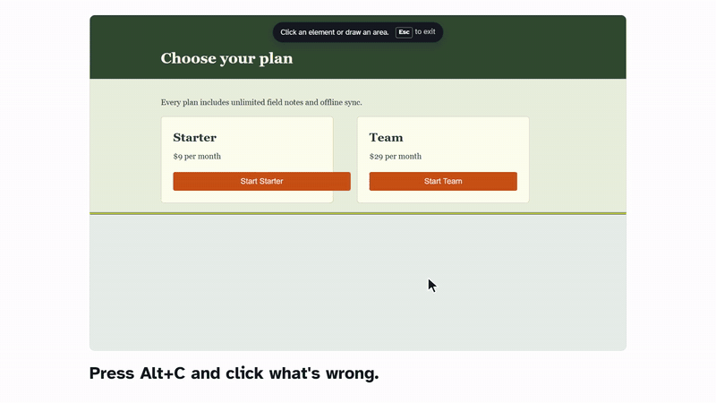

# Markspot

Markspot is a browser extension for Claude Code. You click an element on a web page (or drag over an area) and write what is wrong with it. Claude Code reads the note and its two screenshots, finds the source file, fixes it, checks the result in the browser and answers on the page, in the pin next to your note.

[](https://www.youtube.com/watch?v=Qc0xEFUuMCg)

The full demo (45 s) is on [YouTube](https://www.youtube.com/watch?v=Qc0xEFUuMCg).

Français : [README.fr.md](README.fr.md). Every feature is described in the [feature guide](docs/features.md).

## Requirements

- Node 22.18 or later.
- Claude Code.
- Chrome or Brave.

Markspot is tested on Linux and Windows. The install on macOS has not been tried on a real machine yet.

## Install

```sh
npm install -g markspot
markspot install
```

`install` cannot add the extension to your browser by itself, so it ends with a "to do" line:

1. Add Markspot from the [Chrome Web Store](https://chromewebstore.google.com/detail/okaabbekcogbhighojhlcbmdohahonie). Brave installs it from the same page.
2. Open a new terminal, so that your shell picks up the `claude` function that `install` added.
3. Open a web page and press Alt+C. The extension connects to the local program.
4. Run `markspot doctor` to check every step.

If Alt+C does nothing, set the shortcut in `chrome://extensions/shortcuts`.

### Options

- `--browser chrome`, `--browser brave`, `--browser chrome,brave` or `--browser all` (the default).
- `--chrome-profile <folder>` for a Chrome started with `--user-data-dir`.
- `--cdp http://127.0.0.1:9222` for a Chrome started with a debugging port. `install` loads the extension there, and `doctor` checks the round trip between the extension and the local program.
- `--data-dir <absolute path>` keeps the notes in another folder, for example a network share.
- `--key-file <file>` uses the dispatch key of your other computer.
- `--no-shell` leaves your shell startup files alone. `--shell` adds the `claude` function again after an earlier `--no-shell`.

`install` saves these options in `config.json`, and the next `install`, `doctor` or `uninstall` reuses them.

### What install does

`install` runs these steps in order:

1. Settings. It writes `config.json` with the options you passed.
2. Dispatch key. It creates the key that signs "Send to Claude" dispatches (see [Two machines, one notes folder](#two-machines-one-notes-folder)). An existing key is kept, unless you pass `--key-file`.
3. Host launcher. A small script starts the local program with the full path of Node, because a browser started from a menu does not always have your shell's `PATH`. When Node comes from mise, the path is the folder of its major version (`…/mise/installs/node/26/`), which mise keeps up to date. After a new major version of Node, run `install` again.
4. Markspot command. A second launcher, `markspot`, that Claude Code sessions use to run `markspot listen`.
5. Host manifest for each browser. On Linux and macOS it is a file in the browser's `NativeMessagingHosts` folder, and a browser that is not installed is skipped. On Windows it is a registry key that Chrome and Brave share.
6. Extension. With `--cdp`, `install` loads the extension in that Chrome. Otherwise this step is the "to do" line above, and it counts as done once the extension has connected to the local program.
7. Shell. A `claude` function goes into your shell startup files (`~/.zshrc`, `~/.bashrc`, `~/.bash_profile` on macOS, and the PowerShell profiles on Windows), between a `# >>> markspot >>>` line and a `# <<< markspot <<<` line. Each Claude Code session you start with `claude` can then listen to Markspot (see [Automatic wake-up](#automatic-wake-up-research-preview)). Fish and cmd.exe are not supported.
8. MCP server. It runs `claude mcp add --scope user markspot`. When the registered server points to another Node or another `cli.js` (an old clone, for example), it removes it and adds it again.
9. Skill. It links `~/.claude/skills/markspot` to the skill in the package.

You can run `install` again, and it skips the steps that are already done. `markspot doctor` checks each step, checks that the notes folder is writable and shows when the extension last connected. `markspot uninstall` undoes every step, then deletes the notes and Markspot's folders. A notes folder chosen with `--data-dir` stays, since another computer may use it, and a configuration folder that holds files Markspot did not create stays too.

## Updating

```sh
npm install -g markspot
markspot install
```

`install` redoes only the steps that changed. The Chrome Web Store updates the extension on its own. Do not run `markspot uninstall` to update, because it also deletes your notes.

If you loaded the extension with "Load unpacked" before it was on the Chrome Web Store, remove that copy in `chrome://extensions`, then add Markspot from the store. The notes the local program has received stay in place. A note that still shows "Pending" is only in the browser, and removing the extension deletes it: check that no note shows "Pending" before you remove the extension.

A beta (`npm install -g markspot@next`) can need a newer extension than the one on the store. The package includes it: in `chrome://extensions`, turn on developer mode, click "Load unpacked" and choose `$(npm root -g)/markspot/extension`.

## How it works

1. In the browser, press Alt+C (or click the Markspot icon), click an element or drag over an area, then write your comment.
2. Markspot keeps the page address, the element (selector, visible text, useful attributes, computed styles), the screen size and two screenshots: a close-up of the area and the whole screen with the area framed.
3. The comment box opens on the screenshot. You can draw on it (arrow, rectangle, pen) to show what is wrong.
4. In Claude Code, say "fix my annotations". Claude reads each note with its screenshots, finds the source file, fixes it and checks the result in the browser.
5. On the page, the pin turns to "Resolved" and shows Claude's reply.

Three parts do the work:

- a Chrome extension (Manifest V3);
- a local program, `markspot host`, that the browser starts itself through native messaging. It is the only part that writes notes, and it opens no network port;
- an MCP server, `markspot mcp`, that each Claude Code session starts to read and resolve notes.

Notes are JSON and PNG files in `~/.local/share/markspot` on Linux, `~/Library/Application Support/markspot` on macOS and `%LOCALAPPDATA%\markspot` on Windows.

A note shows "Pending" until the local program has received it, for example when Markspot is not installed on this computer yet. Pending notes go out on their own at the next connection.

## Sending notes to Claude

On the page, the "Send to Claude" button sends the open notes to a Claude Code session. The "Send to" picker lists the sessions that are listening, by project name (the name of the session's folder). The choice is kept per site, and "Refresh" reloads the list. A dispatch waits up to 24 hours for the chosen session to listen.

A session listens in one of two ways.

### Listen mode (default)

Tell the session "listen to my annotations". Claude runs `markspot listen --name <project>` as a background command, which uses no tokens while it waits and exits when notes arrive. Claude fixes them, then starts listening again. Say it again in each new session.

If Claude waits with the `markspot_wait_for_annotations` tool instead of the command, the session also shows in "Send to" while it waits and for 10 minutes after.

### Automatic wake-up (research preview)

When you start `claude` in a terminal after `install`, Markspot asks by default:

```text
Should Markspot listen to this session? [y/N] (no in 5 s)
```

`y` (or `o`) starts Claude with Markspot. Enter, any other key or no answer for 5 seconds starts Claude without it, and Ctrl+C starts nothing. The question is in French when your terminal locale starts with `fr`.

To skip the question, right-click the Markspot toolbar icon and open "Automatic wake-up". "Ask each time" keeps the question. "Always" starts Claude with Markspot and "Never" starts it without Markspot, both without asking. The choice is saved in the notes folder, so two computers that share that folder follow the same choice. The submenu shows only while the extension is connected to the local program.

- When a session already listens to this project (same folder name) on this computer, the new session starts without Markspot and without the question, whatever the choice.
- `claude -p`, `claude mcp …`, `claude --version` and scripts are left alone.
- Your options reach `claude` unchanged, your permission mode included.
- To start Claude without this function, run `command claude` (sh, bash, zsh), or install with `--no-shell`.

You can also start Claude Code with `markspot claude` instead of `claude`. The options that follow go to `claude`. Because the session wakes up without you, `markspot claude` starts it with `--permission-mode default` (Claude asks before each command), unless you choose a mode yourself with `--permission-mode` or `--dangerously-skip-permissions`.

Either way, the session shows in "Send to" on its own, even when idle, and wakes up when you send notes. It does not need `markspot listen`.

This uses Claude Code channels, which are a research preview. For a server that is not an Anthropic-approved plugin, Claude Code opens channels only with the `--dangerously-load-development-channels server:markspot` flag, which Markspot adds for you:

- at startup, Claude Code shows a warning and asks you to confirm "I am using this for local development";
- the flag is meant for development, so its form can change from one Claude Code version to the next;
- the regular `--channels` flag only accepts Anthropic-approved plugins, and Markspot is not one, so listen mode stays the default;
- channels need an interactive session (not `claude -p`) and a claude.ai login or a Console key. In a Team or Enterprise organization, an admin has to turn channels on.

The message pushed into the session holds only the number, id and comment of each note. Claude reads the page data and the screenshots with `markspot_get_annotation`, as in listen mode.

Claude Code does not confirm that it received the message, so the dispatch stays pending until Claude opens one of its notes. If nothing happens for 2 minutes (warning declined, channels turned off by an admin), the dispatch goes back in the queue and the session leaves "Send to" until its next tool call. Tell the session "listen to my annotations", and `markspot listen` picks up the dispatch.

## Using Markspot from Claude Desktop

Claude Desktop can review a site for you and hand its notes to one of your Claude Code sessions. For example, tell it "analyze this website and send it to one of my sessions". This option is off by default.

1. Add the Markspot MCP server to Claude Desktop. After `markspot install`, `claude mcp get markspot` prints the two paths to use: `Command` is Node and `Args` starts with Markspot's `cli.js`. In Claude Desktop, open Settings, then Developer, then "Edit Config", and add this to `claude_desktop_config.json` with your own paths (on Windows, double each backslash):

   ```json
   {
     "mcpServers": {
       "markspot": {
         "command": "C:\\Program Files\\nodejs\\node.exe",
         "args": ["C:\\Users\\you\\AppData\\Roaming\\npm\\node_modules\\markspot\\dist\\cli.js", "mcp"]
       }
     }
   }
   ```

   Then restart Claude Desktop.
2. Turn the option on: right-click the Markspot toolbar icon and check "Claude Desktop can send notes". The option is saved in the notes folder and shows only while the extension is connected to the local program. Claude Desktop gets three more tools within a few seconds. If they do not appear, restart Claude Desktop.
3. Start a Claude Code session that listens, as described in [Sending notes to Claude](#sending-notes-to-claude).

Claude Desktop then works in this order:

1. It lists the sessions that listen for the page (the same list as "Send to") and asks you which one gets the notes.
2. It opens the site with its own browser tool, analyzes it and prepares one note per problem, with a CSS selector, the element's text and, when it can, screenshots.
3. It shows you the prepared notes as a numbered list. You say which numbers to send: all of them, some of them or none.
4. It sends only those notes. The session wakes up, fixes them and resolves each note with a reply.
5. It reads the replies, checks the page again and offers you another pass.

On the page, a note from Claude Desktop shows "From Claude Desktop" in its card and in the notes menu. Claude Code reads it like your own notes, as a suggestion to evaluate. Such a note can have no screenshot. Every computer that shares the notes folder needs Markspot 0.5.0 or later to read these notes.

While the option is on, any program on this computer that starts the Markspot MCP server can create notes and wake a listening session. This is the same access that the dispatch key already gives to any program running under your account. Nothing listens on the network, and the extension asks for no new permission. Turn the option off when you do not use it.

## Language

The extension is in English by default and also in French. Right-click the Markspot toolbar icon, then "Language". "Auto (browser language)" uses French when the browser is in French and English otherwise, and "English" and "Français" set the language. The choice is kept in the browser.

The question that `claude` asks at startup follows the terminal locale (`LC_ALL`, `LC_MESSAGES`, then `LANG`).

## Two machines, one notes folder

To annotate on one computer and let Claude Code fix the notes from another, both read the same notes folder over the network. Share only that folder, for example a Samba share `markspot-notes` whose path is `~/.local/share/markspot`. On the computer that does not hold the folder, install with `--data-dir` and an absolute path to the share, for example on Windows:

```sh
markspot install --data-dir \\server\markspot-notes
```

The launchers and the host manifest stay on each computer. Only the notes, and the automatic wake-up choice, go through the share.

Both computers sign their "Send to Claude" dispatches with the same key. A session only accepts dispatches that are signed, less than 25 hours old and never seen before, so a file dropped or copied on the share cannot wake it up. `install` creates the key on the first computer. Copy it once to the second:

1. On the first computer, `markspot key` prints the key. Save it to a file, on a USB stick for example.
2. On the second, run `markspot install --key-file <that file>`, then delete the file.

The key is kept outside the notes folder: `~/.config/markspot/dispatch.key` on Linux, `~/Library/Application Support/markspot-key/dispatch.key` on macOS and `%LOCALAPPDATA%\markspot-key\dispatch.key` on Windows. Share only the notes folder, never your whole home folder. The key would go through the share too, and anyone who can write to it could forge a dispatch.

## Privacy and security

- Markspot itself sends nothing outside your computer. It has no telemetry and no server. Notes and screenshots reach the model only through your own Claude Code session, when it reads them. The full policy is in [PRIVACY.md](PRIVACY.md).
- No process listens on the network. The browser lets only the Markspot extension, recognized by its fixed id, talk to the local program.
- Screenshots are not masked yet ([issue #22](https://github.com/adryserage/Markspot/issues/22)). Whatever the screen shows at capture time, such as a password shown in clear or a token, goes into the image and on to the model. The preview in the comment box lets you cancel. Text typed in form fields is never stored in the note's data.
- On third-party sites, the page's own scripts can read what you type in the comment box ([issue #23](https://github.com/adryserage/Markspot/issues/23)).
- On a site in development (Vue, Svelte, React), the note keeps the component name and its source file path as the build tool reports it. That path can contain your user name. It stays in the notes folder and in exports.
- On macOS and Linux, files are created with mode 0600 and folders with 0700. On a network share, the share's permissions apply, and anyone who can write to it can drop a note. Claude treats every comment as a request to evaluate.
- With "Claude Desktop can send notes" on, any program on this computer that starts the Markspot MCP server can create notes and wake a listening session (see [Using Markspot from Claude Desktop](#using-markspot-from-claude-desktop)).
- The dispatch key signs "Send to Claude" dispatches. Keep it secret, and keep it out of any shared folder (see [Two machines, one notes folder](#two-machines-one-notes-folder)).

## Adding a browser

Chromium-based browsers (Edge, Vivaldi, Arc…) are declared in `src/cli/browsers.ts`, one entry each, saying where the browser looks for the local program on each system. `install`, `uninstall` and `doctor` pick it up on their own. Add its test to `tests/unit/browsers.test.ts`.

## Development

From a clone:

```sh
git clone https://github.com/adryserage/Markspot
cd Markspot
npm install
npm run build
node dist/cli.js install
```

Then, in `chrome://extensions`, turn on developer mode, click "Load unpacked" and choose the `extension/` folder of the repository. Remove the store copy first, since both have the same id, and check before that no note shows "Pending". From a clone, `node dist/cli.js` stands in for `markspot` in every command of this page.

```sh
npm run build       # dist/cli.js and extension/dist/
npm run typecheck   # tsc --noEmit
npm test            # unit tests (node --test)
npm run smoke       # the built MCP server, markspot listen and the Claude Desktop flow
npm run e2e         # end-to-end tests on a dedicated Chrome with CDP on 127.0.0.1:9223
npm run e2e:real    # a real Claude Code session end to end (costs a few turns)
```

`npm run e2e` does not build, so run `npm run build` first. Set `MARKSPOT_CDP` to use another debugging port.

The design notes are in [docs/conception.md](docs/conception.md) (in French).

## Changelog

The changes in each version are in [CHANGELOG.md](CHANGELOG.md).

## License

Apache 2.0. See the LICENSE and NOTICE files (the Atkinson Hyperlegible fonts are under the SIL OFL 1.1 license).
